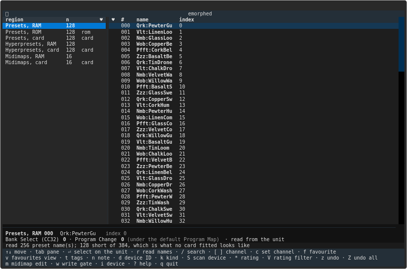
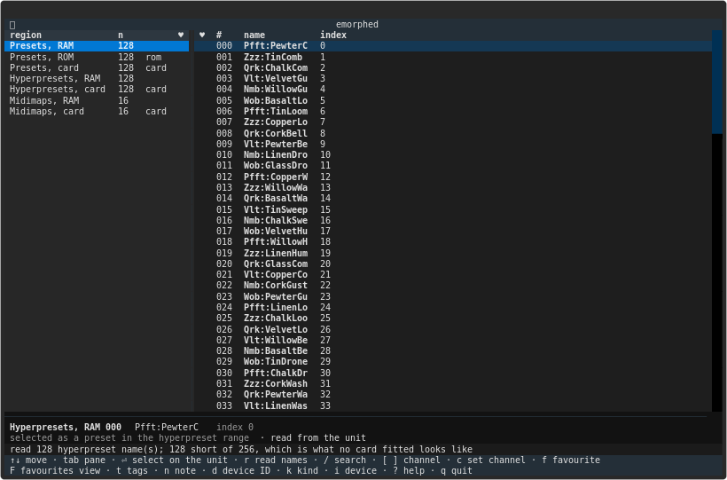
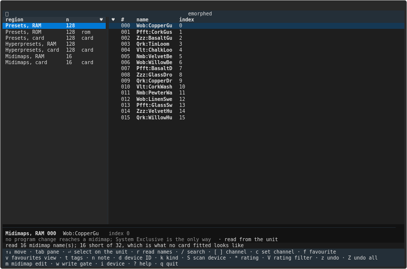
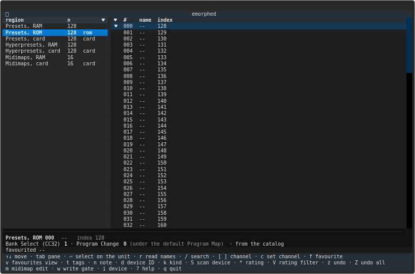
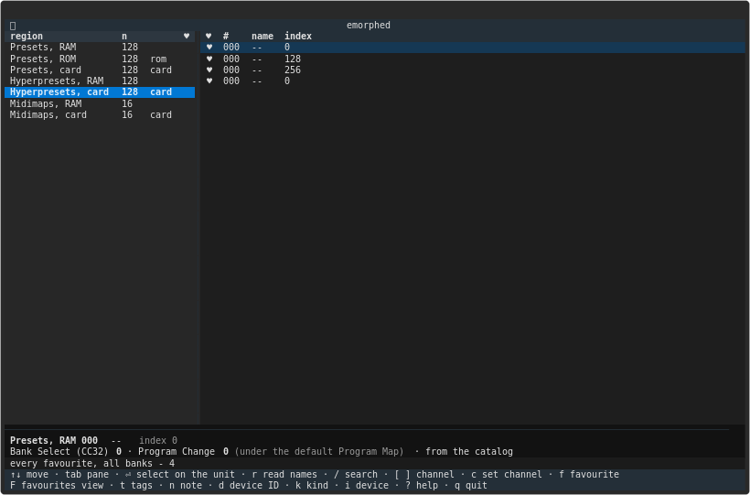
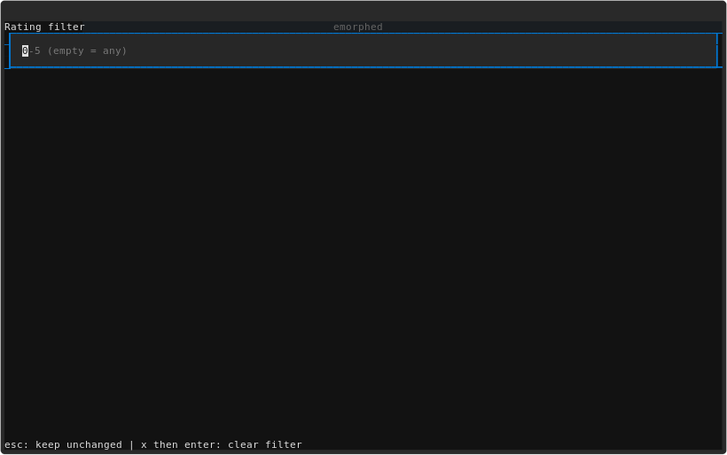
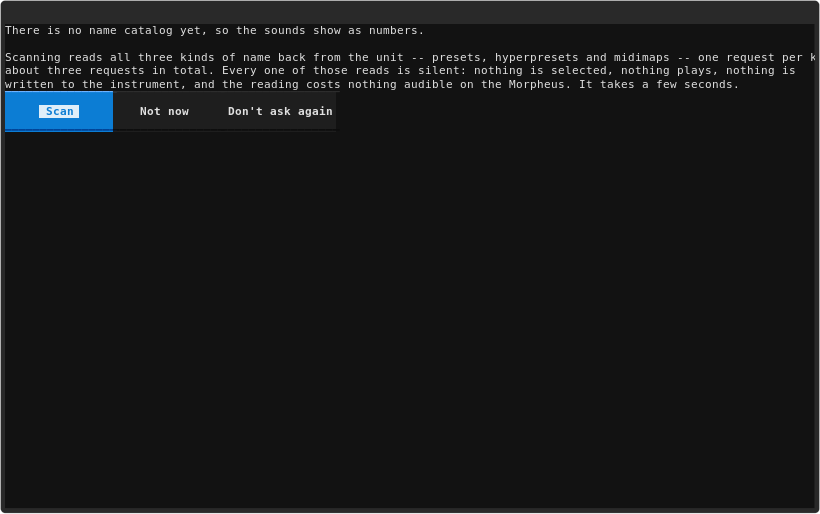
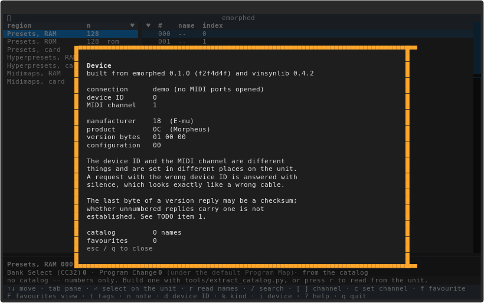
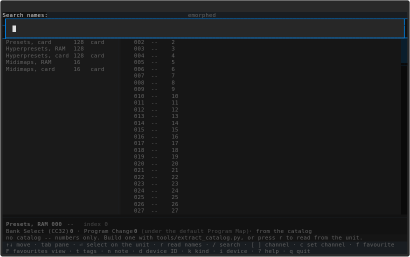
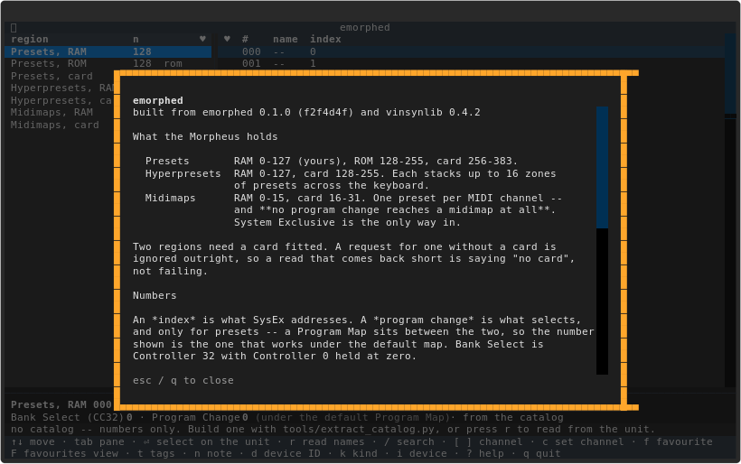

<!-- SPDX-License-Identifier: GPL-2.0-or-later -->
<!-- SPDX-FileCopyrightText: Copyright (C) 2026  emorphed contributors -->

# emorphed

A terminal browser for the **E-mu Morpheus** — its presets, hyperpresets
and midimaps, and the Z-plane machine's awkward habit of numbering
everything three different ways.

Sibling to [rxved](../rxved), [kwsed](../kwsed), [p2ked](../p2ked),
[x5ded](../x5ded), [nanosyned](../nanosyned) and
[ensqsqed](../ensqsqed), and it follows their conventions.

## Support this project

emorphed is free software and always will be. Nothing is behind a paywall, no
feature is withheld, and none of what follows changes that.

But if it has been useful — if it saved you an evening of mapping zones
by hand, or got a library onto a machine that had no way of reading it, or
**best of all, if it has your vintage instrument switched on and in use more often
than it was, and you are having more fun with it** — then please consider
supporting the work.

**Because here is what it has actually cost:**

- **Real machines on a real bench.** Much of what these tools know about these
  formats was measured on hardware rather than read anywhere, because for most
  of it there is nowhere to read it. That needs the machines — the instruments
  themselves — and it puts hours of wear on hardware that has been locked up and
  recovered more than once in the course of it. Some of these instruments were
  bought specifically to add and verify a format; the others were already here,
  because the person doing this is a vintage instrument enthusiast first and the
  projects exist because the instruments were in the room.
- **Dozens — realistically hundreds — of hours of human time.** Format
  reverse-engineering is slow: measure, be wrong, measure again. A single
  parameter law in this README can represent an evening at the bench.
- **AI assistance, which is a paid service**, used heavily throughout and not
  cheap at this volume.

**This is support, not a donation — and the distinction is a legal one, not a
turn of phrase.** The maintainer is based in Germany, where payments like these
are *not* `Spenden` in the tax sense: they count as **taxable income** for the
recipient and are **not tax-deductible** for the giver. So this section is
titled *Support*, deliberately, and no receipt for tax purposes can be issued.
(That is a statement of how it is handled here, not tax advice.)

If the project saved you the work, you can support it through
**[GitHub Sponsors](https://github.com/sponsors/lentferj)** — the *Sponsor*
button at the top of the repository. Payment is handled entirely by GitHub and
Stripe, so bank and tax details are never handed to the person paying.

**Support is not expected, and it is not the only currency.**

- **Bug reports** — ideally with the bank, preset or disk image that produced
  them. A tool's failures are usually specific to one file rather than
  general, and without that file they are very hard to reproduce.
- **Confirmations from hardware that is not on this bench**, which matters more
  here than for a single-machine tool. These tools write for whole *families*
  of instruments, and the bench holds only a subset. Whether a variant accepts
  what we write is genuinely unknown, and several notes say "on this unit" for
  that reason. A "loads fine here too", or a "no, mine refuses it", is worth a
  great deal.
- **Corrections to the reverse-engineering notes.** The wrong turns are
  recorded next to the findings in `docs/RESOLUTION_NOTES.md` — retractions
  included, because a finding that was withdrawn is as useful as one that
  stood. If any of it is wrong in a way that is still costing someone time,
  saying so improves the record.

---

---


## AI assistance & human authorship

emorphed was built by its human author together with AI assistance. The
**ideas, the project vision, and every feature** came from the human author;
AI assisted with **writing the code and analyzing the binary formats**.
Crucially, the **reverse engineering rests on hands-on human work** — all testing
and verification on real hardware, creating the reference images/banks on those
instruments (disk saves, SysEx probes), and aural A/B comparison of presets —
which is what makes the results correct.
Full account in [DISCLAIMER.md](DISCLAIMER.md).

---
## ⚠️ Use at your own risk — back up first

 is provided **as is, with absolutely no warranty and no liability**
for data loss or **hardware damage**. You assume all risk. Full terms:
[DISCLAIMER.md](DISCLAIMER.md).

Before you use this software, **make good, current backups of all your files** —
and of any existing banks on your instrument and storage media. These tools can
write to hardware and storage media; a mistake, a bug, or untested output could
overwrite or corrupt data, or be rejected by hardware. Always test on a spare
unit or emulator **before** connecting irreplaceable equipment.

---

## What makes this one different

**The manual is the specification.** E-mu printed all twenty-six pages of
the MIDI spec as a chapter of the Operation Manual instead of making you
write away for it, which is the opposite of the SQ-R next door.

**One message gets every name.** `Preset List Request` returns all of
them, in the order the instrument shows them. None of the sibling
instruments can do that.

**Data is fourteen bits wide.** Every value is two MIDI bytes, low seven
first, signed two's complement sign-extended to bit 13 — *whatever* the
parameter's documented range. Read a dump a byte at a time and you get
plausible halves of numbers.

**Bank Select is Controller 32**, with Controller 0 held at zero:
`Bn 00 00 20 bb Cn pp`. That is the opposite way round from
[nanosyned](../nanosyned)'s instrument, which ignores 32 entirely. The
bank number is **measured, not arithmetic** (2026-10-16): RAM presets are
bank 0, ROM presets bank 1, RAM hyperpresets bank 2, card presets **bank
3**, and card hyperpresets bank 4. A Program Change therefore does reach a
hyperpreset — this card numbering is why a card preset was once sent one
bank too low. A midimap has no Bank Select bank and no Program Change at
all; it is made current over System Exclusive.

**A preset index is not a program number.** The index is what SysEx
addresses; a Program Map decides what program change reaches it. The code
keeps them apart and says so when it assumes.

## Memory

| region | indices | n | |
|---|---|---|---|
| Presets RAM | 0–127 | 128 | writable |
| Presets ROM | 128–255 | 128 | |
| Presets card | 256–383 | 128 | card only |
| Hyperpresets RAM | 0–127 | 128 | writable |
| Hyperpresets card | 128–255 | 128 | card only |
| Midimaps RAM | 0–15 | 16 | writable |
| Midimaps card | 16–31 | 16 | card only |

## Install

```sh
python3 -m venv .venv
.venv/bin/pip install -e .
```

Needs Python 3.11+, `python-rtmidi` and `textual`, plus **vinsynlib** — the
shared base of this family of terminal instrument tools: the settings cache,
the keymap and legend, the command line and the port listing. It comes from
PyPI with the rest. To develop against a *working copy* of it instead of the
published one, install that alongside — it shadows the published version in
this environment only: `.venv/bin/pip install --no-deps -e ../vinsynlib`.

## Running it

The package installs two console scripts, `emorphed` (the browser) and
`morphcli` (the command line). Called through the checkout's environment as
`.venv/bin/...`, they work without activating anything:

```
.venv/bin/morphcli regions          # the memory map
.venv/bin/morphcli --demo names     # every name, in one exchange
.venv/bin/morphcli read dump.syx    # read a .syx, verify checksums
.venv/bin/morphcli status           # ask the unit who it is
```

Browser:

```
.venv/bin/emorphed                     # the unit remembered in config.toml
.venv/bin/emorphed --demo              # built-in demo device (no MIDI ports)
.venv/bin/emorphed --scan              # probe every port and update config.toml
.venv/bin/emorphed --live-names PATH   # where names read from the unit are kept
.venv/bin/emorphed --allow-write       # arm the write gate at startup
```

`python -m emorphed.cli …` and `python -m emorphed.app …` also work from a
checkout, and so do the bare `emorphed` / `morphcli` names once the
environment is active. `python -m emorphed` does not: the package has no
`__main__`, by the family's convention that the console scripts are the
entry points.

**Two speeds of connect.** Plain `emorphed` asks the port and device ID
remembered in `config.toml` with **one** Version Request — measured at
**0.09 s** (round it to ~0.1 s). `--scan` throws that away and sweeps: every
output port × **16** device IDs, each probe up to **0.4 s**. On the bench
host that is **41 ports**, so a device-7 unit is reached on the eighth ID
pass in **~2.2 min**, and the worst case is `41 × 16 × 0.4 s` ≈ **~4.4 min**.
The sweep is only needed when the port or the device ID has changed. When it
has, don't pay it: `emorphed --port "<port>" --device-id 7` (or
`morphcli … status`) opens that port directly, remembers both, and makes the
next plain run instant. The full cost note is TODO item 1.

`read` checks every dump's checksum, so it can tell you a file is
*damaged* rather than only that it is the wrong length.

## What the browser does

Two panes: regions on the left, that region's slots on the right. Favourites,
tags, notes, search, device info. Morpheus-specific:



- **One message gets every name.** `r` reads all names of the current kind in
  a single exchange — this instrument can do that and its siblings cannot.
  Reading names is **silent**: it plays nothing. Names from the unit show
  in bold; a `*` marks a slot where the unit and the catalog disagree.
- **Three kinds in one browser.** `k` cycles the right pane across preset →
  hyperpreset → midimap views. Names for all three kinds are read the same
  silent way. `enter` selects presets **and hyperpresets** — a Program
  Change reaches a hyperpreset, sent with bank 2 (RAM) or bank 4 (card). A
  midimap is refused with a plain sentence: no Program Change reaches a
  midimap at all, it is made current over System Exclusive.





- **Favourites**, with ratings, tags and notes, in SQLite under the per-platform
  data directory. `f` favourites the slot under the cursor, `t`/`n` set tags
  and note, `*` rates it 0–5. `v` cycles all slots → this bank's favourites →
  every favourite; `V` narrows by rating (exactly, or that many and up; stacks
  on top of the view).







- **Undo.** `z` reverses the last favourites/rating/tags/notes change, `Z` all
  of them, restoring previous values. The undo log is the favourites store's
  log, not a separate buffer.
- **Editing a midimap.** `m` opens the current midimap's own parameters in a
  modal: one row per word, `+`/`-` to nudge, digits to type, `⏎` to pick a
  named value from an enumeration, `r` to re-read. Writes are **gated**: the
  gate is locked by default, `w` arms it (and `--allow-write` arms only the
  *start* state), and a locked gate refuses rather than sends. The **first**
  write backs the whole midimap up first -- a failed backup is announced and
  the parameter write still proceeds; only the STORE refuses without a
  successful backup this session;
  every write is read back, and only an agreed read-back is logged for `z`/`Z`
  undo. `s` is the **store** -- sending the whole map to a location -- and is
  **arm-then-fire**: it asks for a location, says what it erases, and waits
  for a confirmation, and it is refused outright without a backup. What a
  parameter write changes is the unit's *scratch* midimap, live; only a store
  makes it permanent.
- **Live names kept between sessions.** Names read off the unit go into
  `live-names.json` beside the favourites database, so the browser opens on
  your patches rather than the factory list. Override the path with
  `--live-names`. `rxvcli`-style sharing is via the same file.
- **Scan.** `S` learns names for all three kinds (silent, one exchange each
  per kind) with progress on a shared `ScanScreen`; cancel is checked between
  kinds. A scan offer appears when the catalog is empty. No sound accompanies
  any of this on the Morpheus — there is no per-bank play.



- **Device ID is its own thing.** `d` sets the SysEx device ID (0–15 on the
  wire), `c`/`[`/`]` the MIDI channel. A wrong device ID is answered with
  silence, which is indistinguishable from a wrong cable.



Keys (full set): arrows move (never sends anything); tab switches pane; `⏎`
select on the unit (presets and hyperpresets; a midimap is made current
over SysEx, behind a confirmation); `r` read names; `m` midimap edit;
`w` write gate; `/` search; `[`/`]`/`c` channel; `d` device ID; `f`
favourite; `v` favourites view; `t`/`n` tags/note; `*` rating; `V` rating
filter; `z`/`Z` undo; `k` kind view; `S` scan; `i` device info; `?` help;
`q` quit.





Remembered between runs: the rating filter (`rating_stars`, `rating_at_least`)
and the scan-offer dismissal (`scan_offer_dismissed`), via the config's
ui-state wrappers.

## Command line

```
morphcli ports
morphcli regions
morphcli list {P-RAM,P-ROM,P-CARD,H-RAM,H-CARD,M-RAM,M-CARD}
morphcli names {preset,hyperpreset,midimap}
morphcli status
morphcli select {P-RAM,P-ROM,P-CARD} number
morphcli read FILE {preset,hyperpreset,midimap}
morphcli fav [--add REGION:N] [--remove REGION:N] [--rate REGION:N 0-5] [--tags TAGS] [--note NOTE] [--tag TAG] [--search SEARCH] [--rating-at-least 0-5 | --rating-exactly 0-5] [--order {added,rating,bank,name}]
morphcli tags
morphcli backup list [--dir DIR] [--json]
morphcli backup save {P-RAM,P-ROM,P-CARD} [--dir DIR] --yes
```

Global options go before the subcommand: `morphcli --demo ...`. `ports`,
`regions`, `list`, `fav`, `tags`, `backup list` construct no bridge and open
no port.

## Backups

`morphcli backup save REGION` reads a whole RAM region (128 preset requests,
paced by `PRESET_GAP`) into a backup envelope, behind `--yes` because it
reads from the unit. `morphcli backup list` shows them newest-first; corrupt
files are listed with `error`. There is deliberately **no `restore`
command**: presets are never written, and the one write path -- midimap
*parameters* -- keeps its own backup and read-back instead (TODO item 6).
`load` exists in `emu/backup.py` for a restore that has not been built;
today only capture is offered.

## The bench, real hardware

`make test-hardware` drives a real E-mu Morpheus. It is **not** part of
`make check`, and no agent runs it unless explicitly authorised. Build-only
verification (no device traffic):

```
.venv/bin/pytest tests/test_hardware.py --hardware --collect-only -q
```

The suite asks read-only questions and prints observations for the human to
record: version round-trip, configuration (RAM sizes, card presence — TODO
item 2), name lists (structure, no values asserted), `read_preset`
checksum recomputation (TODO item 1's ER-2 bench step), a full-bank
request's per-frame checksum status, and a timing probe of `PRESET_GAP`.
Selecting is not in the suite because it moves the unit: that bank question
was settled separately, by the human-attended
`tools/bench_bank_numbers.py --yes`, which plays the unit (TODO item 9).

## Honest limits

- **Presets are never written.** Nothing sends Preset Data to the unit;
  `select` is the only emitter and plays a preset, and `restore` is not
  offered. Midimap *parameters* can be written, but only behind the gate,
  after a backup and with a read-back (TODO item 6).
- **A midimap store is destructive and fenced.** Sending a whole midimap to
  a location erases what is there (manual p.36). It is arm-then-fire, names
  the location, needs a confirmation and a backup first -- and it is
  unverified on hardware, as is the whole write path.
- **No category filter.** The Morpheus printed catalog carries no categories;
  there is nothing to filter on.
- **`PRESET_GAP` is a guess** (TODO item 3), labelled as one; the bench
  measures it.
- **The card's select bank is 3, not 2** (TODO item 9, resolved 2026-10-16
  by measurement). A card preset sends Bank Select **3**; hyperpresets are
  banks 2 (RAM) and 4 (card). The earlier `index // 128` arithmetic sent 2,
  which reached the hyperpresets instead.
- **Unnumbered replies' checksum status is unknown** (TODO item 1). `parse`
  strips the checksum only for the three numbered data messages.
- Patch names are not redistributed: `emu/data/catalog.json` is gitignored
  and generated by `tools/extract_catalog.py` from your own files.

## Development checks

A no-AI quality gate. Install the dev tools, then run everything:

```
uv sync
make check          # or: uv run make check
```

`make check` runs each stage in sequence and stops at the first failure:

| target | what it does |
|---|---|
| `make lint` | `ruff check` + `ruff format --check` — lint (E, F, I, B, S, SIM, UP, C4, PL, RUF, C901) and formatting |
| `make format` | `ruff format` — apply formatting manually |
| `make typecheck` | `mypy --strict emorphed emu tests` |
| `make test` | `pytest` with coverage (`--cov-report=term-missing`, no threshold) |
| `make audit` | `pip-audit`, `vulture`, `deptry`, `detect-secrets audit` |

`pre-commit install` (once) runs ruff (lint + format), mypy and detect-secrets
on every commit. shellcheck/shfmt are omitted — this repo has no shell
scripts.

The code is clean under every gate: ruff (lint + format), mypy strict, and the
audit tools all pass without suppressions. `rtmidi` and `nano` ship no type
stubs, so mypy is told to ignore those two imports. `setuptools>=83` is pinned
as a dev dependency to keep `pip-audit` clear of the build tool's known
vulnerabilities.

## Licence

GPL-2.0-or-later. AI assistance was used; see `DISCLAIMER.md`.
